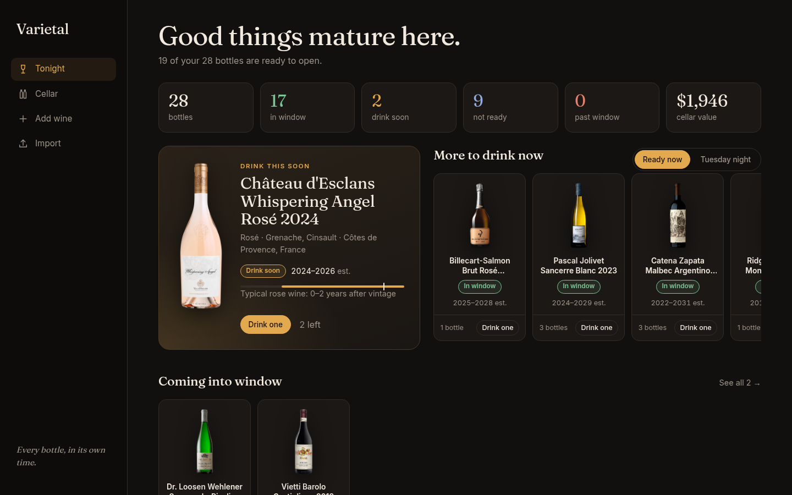

# Varietal

A free and self-hostable way to track your cellar.



Varietal is a personal wine cellar tracker. Look wines up on the web, keep track of bottles, and see what's in its drinking window.

## Features

- **Tonight**: see the bottle to open next, what else is ready to drink, what's coming into its window, and stats for your cellar.
- **Add wine**: search the web to fill in a wine's details and label image.
- **Drinking windows**: every wine gets an estimated window, with the reasoning shown, and you can override it.
- **Import**: bring in an existing spreadsheet as CSV.
- **Export**: download your whole cellar as a JSON file and load it into another Varietal instance.

### Tonight

Ready-to-drink wines are listed most urgent first. Switch to **Tuesday night** to see in-window bottles from the cheaper end of your cellar. Stats are broken down by type, varietal, style, country, region and vintage.

### Adding wine

Search uses Vivino's catalogue to fill in producer, region, grapes, type, rating and label image.

The server downloads each label image once and stores it in an `images` folder next to the database, so Vivino is only contacted when you search for or add a wine.

### Drinking windows

The estimate is based on the wine's appellation, grapes, type and quality (rating or price). Enter your own window to override it.

### CSV import

Columns are matched automatically. Drinking windows written like `2025-2035`, `2025-30`, `by 2030` or `2028+` are kept. Map a finished column to import wines you've already finished.

### Cellar export

Download the export from the Cellar page, and bring it into another Varietal instance from the Import page. Importing replaces everything in the receiving cellar. The file keeps the label images' original links, and the receiving instance downloads its own copies.

## Getting started

### Requirements

- Node 24 or later. Varietal uses the built-in `node:sqlite` module and Node's native TypeScript support.
- pnpm

### Development

```sh
pnpm install
pnpm dev
```

This runs the API on port 3001 and the app on http://localhost:5173.

### Production

For everyday use, build once and run a single server:

```sh
pnpm build
pnpm start
```

The app is served on http://localhost:3000.

Your cellar is stored in `data/cellar.db` (SQLite). See [Configuration](#configuration) to change the location or port.

## Docker

```sh
docker compose up -d --build
```

Or without Compose:

```sh
docker build -t varietal .
docker run -p 127.0.0.1:3000:3000 -v varietal:/app/data varietal
```

The app is served on http://127.0.0.1:3000 by default.

> [!WARNING]
> The API has no authentication, so it's bound to localhost only. Only bind to `0.0.0.0` on a trusted network, or put a reverse proxy with auth in front.

Change the host port and interface with `VARIETAL_PORT` and `VARIETAL_BIND`, either inline or in a `.env` file next to `docker-compose.yml`:

```sh
VARIETAL_PORT=8080 VARIETAL_BIND=0.0.0.0 docker compose up -d   # reachable on your LAN at :8080
```

Inside the container the app always listens on 3000.

The SQLite database lives in the `varietal-data` volume mounted at `/app/data`, so your cellar survives container upgrades.

The container runs as an unprivileged user (uid/gid 1000). If you bind-mount a host directory instead of a named volume, make sure it's writable by uid 1000, for example `chown 1000:1000 /path/to/data`.

## Desktop app

```sh
pnpm electron            # run the desktop app locally
pnpm run package         # build an installer for this OS into release/
```

The desktop app keeps its cellar in the OS app data folder rather than `data/cellar.db`.

### Demo cellar

`pnpm electron` doesn't touch an installed app's cellar. It runs from its own `Varietal Demo` app data folder, with a cellar filled from `electron/demo-wines.json` on first launch, and can run alongside the installed app.

- Delete the `Varietal Demo` folder to start over.
- Run `node electron/fetch-demo-wines.ts` to refresh the wines from Vivino.

Packaged builds, including releases, start with an empty cellar as usual.

### Releases

Publishing a GitHub release builds the Linux, macOS and Windows apps and attaches them to the release. The app version comes from the release tag, so tag releases like `v1.2.3`. Merges to `main` don't trigger a build.

The builds aren't signed with a developer certificate, so macOS and Windows warn on first launch.

### Icon

The app icon in `build/icon.png` is the wine glass from [Noto Emoji](https://github.com/googlefonts/noto-emoji), used under the Apache License 2.0. electron-builder generates each platform's icon format from it.

## Configuration

| Variable | Used by | Default | Description |
| --- | --- | --- | --- |
| `DB_PATH` | Server | `data/cellar.db` | Location of the SQLite database. |
| `PORT` | Server | `3001` with `pnpm dev`, `3000` with `pnpm start` | Port the server listens on. |
| `VARIETAL_PORT` | Docker Compose | `3000` | Host port mapped to the container. |
| `VARIETAL_BIND` | Docker Compose | `127.0.0.1` | Host interface the port is bound to. |

## Project layout

- `server/`: Hono API, SQLite storage, and wine lookup
- `shared/`: drink window estimator, grape catalogue, input normalization, and the cellar export format, shared by client and server
- `src/`: React app using TanStack Router (pages and URLs) and TanStack Query (data loading and saving)
- `electron/`: desktop shell that runs the server and opens it in a window

## Testing

```sh
pnpm test
```

This runs the estimator, import-parsing and cellar export tests.

## License

Varietal is released under the [MIT License](LICENSE).
